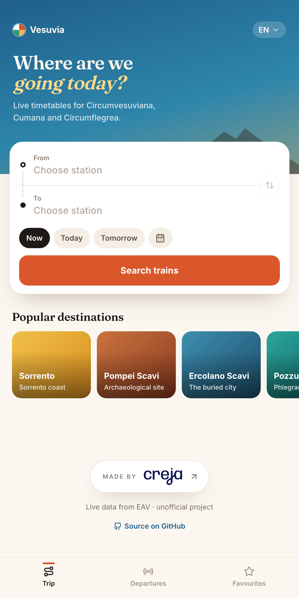
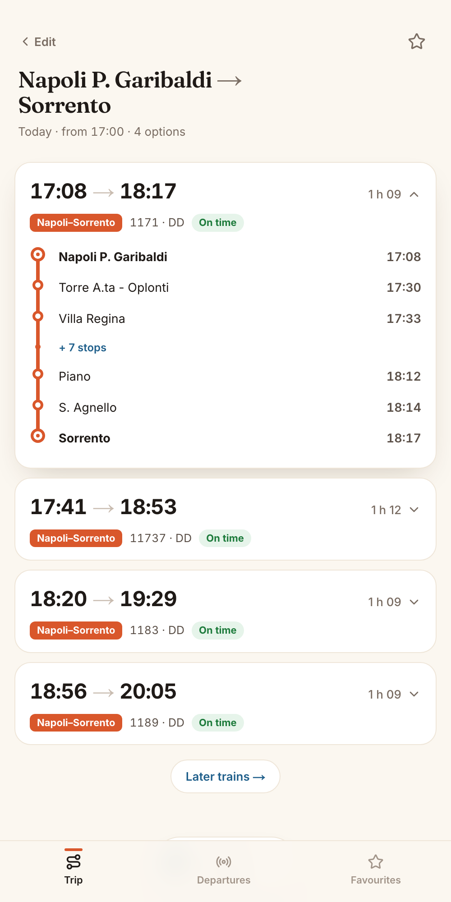
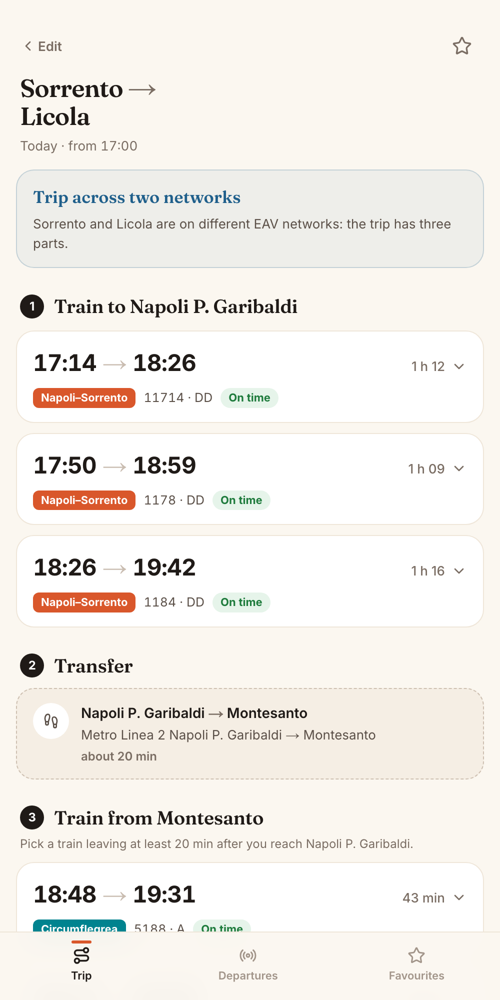
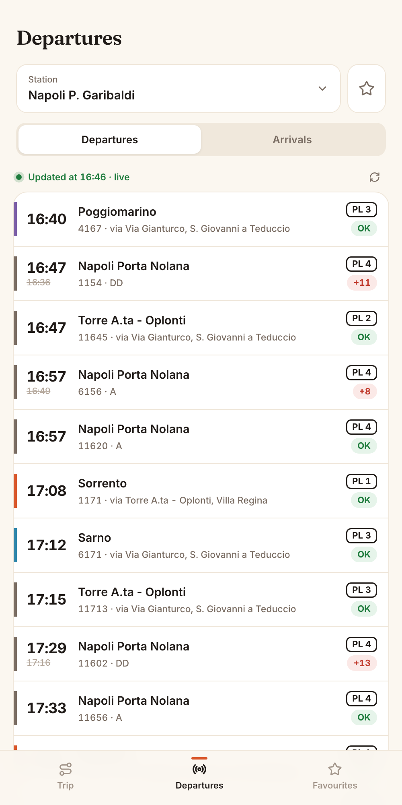
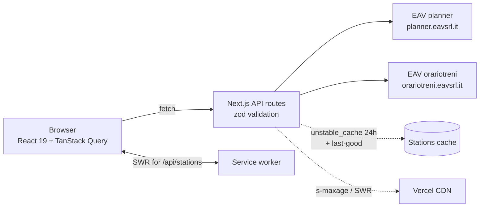

<div align="center">

# Vesuvia

**Live train times for the whole EAV network around Naples: Circumvesuviana, Cumana and Circumflegrea.**

[Live demo](https://vesuvia-search.vercel.app) · [API reference](docs/API.md) · [Architecture](docs/ARCHITECTURE.md) · [EAV notes](docs/EAV.md)

     

</div>

Vesuvia is an unofficial, mobile-first companion for the trains that serve Naples, Pompeii, Sorrento and the Phlegraean coast. EAV (the regional operator) publishes no public API, so the app talks to the same undocumented endpoints its own websites use, validates every payload, and turns them into a clean, fast, installable experience. There is no database and no hand-maintained timetable: stations, lines, journeys and live boards all come straight from EAV.

## Screenshots

<table>
  <tr>
    <td align="center"><br><sub>Search with colloquial station names</sub></td>
    <td align="center"><br><sub>Journeys with step-by-step stops</sub></td>
  </tr>
  <tr>
    <td align="center"><br><sub>Cross-network trip with interchange</sub></td>
    <td align="center"><br><sub>Live departures and arrivals board</sub></td>
  </tr>
</table>

## Features

- **Live data, no hand-maintained lists.** The 161 stations, their lines and live boards are read from EAV and refreshed daily, with a last-good fallback if EAV is down.
- **Colloquial station search.** Type "Sant'Agnello", "Piazza Garibaldi", "Pompei" or even a typo; the app finds "S. Agnello", "Napoli P. Garibaldi" and the right Pompeii stops.
- **Cross-network trip planning.** EAV's planner only routes inside one network. Vesuvia chains two searches through a known interchange (for example Garibaldi to Montesanto by Metro Line 2) so you can go from Sorrento to Pozzuoli in one query.
- **Step-by-step stops** with times for trains leaving soon.
- **Live departures and arrivals boards** for Circumvesuviana, Cumana and Circumflegrea, refreshed every 30 seconds.
- **Favourites and recent searches**, stored on your device.
- **6 languages:** Italian, English, Spanish, Portuguese, French, German.
- **Installable PWA** with a custom service worker and an offline page.

## How it works



1. The browser loads the station list once (cached for a day) and searches it locally, so typing is instant.
2. Journeys, boards and stops go through five thin Next.js route handlers that validate input with zod.
3. Handlers call the EAV planner (stations, destinations, journeys) and orariotreni (line data, HTML boards), validate the upstream payloads, and normalise them into the types in `src/lib/eav/types.ts`.
4. Responses carry CDN cache headers sized to how fast the data changes.

More detail in [docs/ARCHITECTURE.md](docs/ARCHITECTURE.md).

## Interesting problems solved

- **Undocumented endpoints.** The planner redirects to an error page unless the request carries `X-Requested-With: XMLHttpRequest`. The client treats redirects as failures and validates every payload with zod.
- **The 17:05 vs 17:08 mismatch.** Planner segments arrive dated 1900-01-01 and describe the whole train run, not the passenger's leg. Real times come from two per-segment offsets from the run's first departure; the run-level dates merely echo the server's "today". See [docs/EAV.md](docs/EAV.md).
- **Scraping boards.** Live boards are HTML tables served by two different backends (Moova and PIS). They are parsed, entity-decoded and mapped to lines, including the "Ferma a:" stop lists.
- **Network-scoped planner to meta-planner.** Since EAV never connects its networks, the app resolves an interchange pair, searches leg one, then searches leg two starting after the first arrival plus a transfer buffer.
- **Abbreviation-aware fuzzy search.** EAV writes "S. Agnello", "P.zza", "C.so". Names are expanded into variants, matched in ranked tiers (exact, prefix, token prefix, substring, fuzzy) with a curated alias table and Damerau-Levenshtein typo tolerance.

## Getting started

Requires Node.js 20.9 or newer. No environment variables, no database.

```bash
npm ci
npm run dev       # http://localhost:3000
npm test          # Vitest, uses recorded EAV fixtures
npm run lint
npm run build
```

Other useful scripts: `npm run type-check`, `npm run format`, `npm run generate-icons`.

## Project structure

```
src/
  app/
    api/            board, destinations, journeys, stations, train-stops
    components/     AppShell, SearchCard, StationPicker, ResultsView, JourneyCard, BoardView, ...
    offline/        offline fallback page
  hooks/            TanStack Query hooks, localStorage hooks, useNow
  lib/
    eav/            EAV client, planner, board scraper, stations, interchanges, dates, types
    search/         station search (normalisation, aliases, tiered ranking)
    i18n.ts         6 languages, typed dictionaries
    storage.ts      SSR-safe localStorage (favourites, recents)
public/sw.js        service worker
docs/               API, EAV, ARCHITECTURE, design explorations
```

## API reference

| Route | Method | Params | Response |
| --- | --- | --- | --- |
| `/api/stations` | GET | none | `StationsResponse` |
| `/api/destinations` | GET | `from` (station id) | `{ destinationIds: number[] }` |
| `/api/journeys` | POST | JSON `{ fromId, toId, date, time }` | `JourneySearchResponse` |
| `/api/board` | GET | `station`, `type` (`departures` or `arrivals`) | `BoardResponse` |
| `/api/train-stops` | GET | `station`, `train` | `{ stops: BoardStop[] \| null }` |

Errors use `{ error, code }` with `BAD_REQUEST`, `NOT_FOUND`, `UPSTREAM` or `INTERNAL`. Full details in [docs/API.md](docs/API.md).

## Credits and disclaimer

Vesuvia is an independent project and is not affiliated with, endorsed by or sponsored by EAV s.r.l. Timetable and real-time data are the property of EAV (Ente Autonomo Volturno) and are fetched from its public web endpoints. Data may be wrong or unavailable; always check official EAV information before travelling.

Destination photos come from Wikimedia Commons: Sorrento by Kim Traynor (CC BY-SA 3.0), Pompei by Carsten Steger (CC BY-SA 4.0), Ercolano by Diego Delso (CC BY-SA 4.0), Pozzuoli by Ra Boe (CC BY-SA 3.0 DE), Vico Equense by Mario Apuzzo (CC BY-SA 4.0).

## License

[MIT](LICENSE)

---

Made by [Lucio Cocorullo](https://creja.it) · [Creja](https://creja.it) (creja.it)
